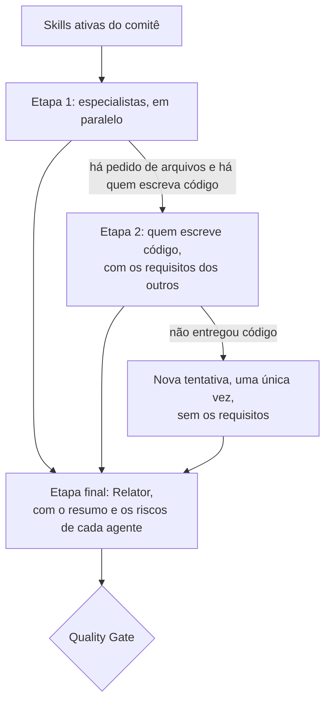
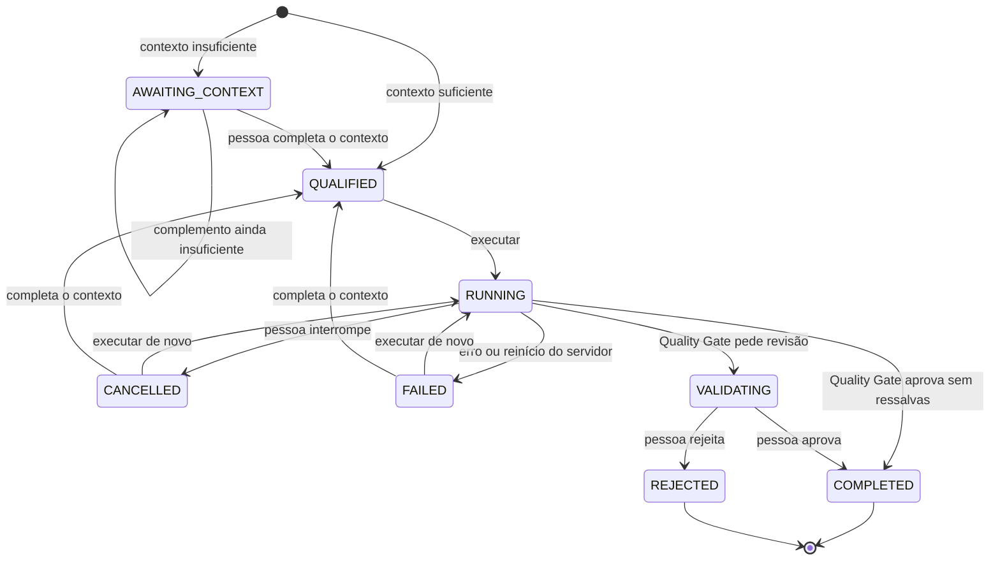

# Visão da Arquitetura

## Objetivo

Validar uma arquitetura de integração de agentes especialistas em ambientes corporativos. O foco não é criar um agente universal, mas coordenar capacidades com responsabilidades, contratos e limites definidos: uma solicitação técnica é qualificada, ganha um `Trace ID`, vai para as Agent Skills de um comitê, passa pelo Quality Gate e pode ser reconstruída pela auditoria.

Os diagramas C4 e os requisitos estão na [RFC](../rfc/). Este documento descreve o que está implementado.

## Decisão estrutural

**Monólito modular** com dois projetos e PostgreSQL. Reduz o custo operacional da Prova de Conceito sem misturar responsabilidades. Separar em serviços só se justifica com requisitos concretos de escala ou isolamento. A exceção são as Agent Skills, que rodam como processos MCP.

```text
frontend/  React, Vite e TypeScript: interface. Nunca decide autorização.
backend/   FastAPI e SQLAlchemy: regras, autorização, persistência e auditoria.
```

## Módulos do backend

| Pasta em `backend/app/` | Responsabilidade |
|---|---|
| `api/` | Rotas REST e documentação OpenAPI |
| `services/` | Orquestração, comitês, arquivos, sugestão de skills, autenticação e LLM |
| `agent_catalog/` | Catálogo de skills, cliente MCP, servidor MCP e contratos |
| `agent_manifest/` | Leitura e validação do manifesto `modelo.md` |
| `quality_gate/` | Regras explícitas sobre as respostas das skills |
| `llm/` | Provedores de modelo, prompts e mascaramento de dados |
| `rag/` | Indexação, embeddings, busca e métricas |
| `models/`, `schemas/` | Tabelas e contratos da API |
| `core/` | Configuração, segurança, limites de requisição e métricas |
| `db/` | Conta inicial e cadastros iniciais (seeds) |

## Fluxo de uma orquestração

A orquestração é um **fluxo em etapas, escrito no próprio código**, sem framework de grafos. Os diagramas abaixo o desenham como grafo.

### Síncrono e assíncrono

- **Para a tela, é assíncrono.** `POST /agent-skills/requests/{id}/start` responde na hora (202), a execução segue em segundo plano e a tela acompanha pela linha do tempo. As skills somam minutos, mais que os 45 s que o proxy do Static Web Apps espera.
- **Entre as etapas, é sincronizado.** Cada etapa só começa quando todos os agentes da anterior terminam. Dentro da etapa, rodam em paralelo, até 3 ao mesmo tempo.
- A API também tem `POST /agent-skills/requests/{id}/execute`, que espera o fim e devolve o resultado na mesma resposta. A tela não a usa.

### Etapas de uma execução



- Sem pedido de arquivos, ou sem as duas turmas, todos os especialistas rodam juntos na etapa 1.
- O Relator roda quando há dois ou mais agentes (o da plataforma) ou quando o comitê tem o próprio.
- Cada chamada de skill passa por MCP: mascaramento, busca na base (RAG), modelo e contrato de saída.
- A falha de uma skill fica registrada e não interrompe as outras. Sem nenhuma resposta, o caso vai para revisão humana.

### Estados e laços



Em `CANCELLED` ou `FAILED`, um complemento insuficiente volta para `AWAITING_CONTEXT`.

### Validação humana

O Quality Gate pede revisão quando há confiança baixa ou média, divergência entre respostas da mesma área, arquivos pedidos e não gerados, pacote de arquivos incompleto, um agente que o Relator deixou de fora ou nenhuma resposta.

- Quem revisa é **quem abriu a solicitação**: aprova ou rejeita, com observações, e a decisão entra na linha do tempo.
- **A revisão não dispara nova execução.** `REJECTED` é um estado final; para tentar de outra forma, abre-se uma nova solicitação.
- **Perguntas de acompanhamento:** depois da primeira resposta, a pessoa pode perguntar de novo no mesmo `Trace ID`. A resposta passa pelo Quality Gate, mas não muda o estado nem abre outra revisão.

Detalhes da IA no [Pipeline de IA](ai-pipeline.md).

## Agent Skills

- **Execução por MCP real**, com o SDK oficial. O Orquestrador é o cliente (`agent_catalog/mcp_client.py`). Em produção, cada chamada usa um subprocesso por stdio, que nunca fica exposto à rede.
- **Um executor e um servidor para todas as skills** (`agent_catalog/tool_interface.py` e `mcp_servers/skill_server.py`). O que muda de uma skill para outra está nos dados: a área, a persona do manifesto e as frases sobre a evidência. Até 08/11/2026 eram 5 executores e 5 servidores quase iguais.
- **Extensibilidade:** uma skill nova, em qualquer área, entra por formulário ou manifesto, sem mudança no núcleo do Orquestrador.

### O que o MCP é aqui, e o que não é

- **É** a fronteira entre o Orquestrador e as Agent Skills: o cliente lista as ferramentas do servidor, confere que `executar` existe e só então chama, com entrada e saída validadas por contrato.
- **É** isolamento de processo: uma falha em uma skill não derruba as outras.
- **Não é** isolamento de permissões: o subprocesso recebe a configuração do backend, inclusive as chaves, e abre a própria sessão no banco. Só o backend o inicia, e ele não fica exposto à rede.
- **Não há conectores MCP externos.** O GitHub é acessado fora do MCP. Ferramentas com dados externos como ferramentas MCP são trabalho futuro ([RFC](../rfc/), Apêndice J).

## Limites arquiteturais

- O frontend nunca recebe chaves de provedor, e a autorização é sempre validada no backend.
- O token de sessão fica só no cookie do navegador, e o banco guarda o hash.
- Uma chamada de modelo não habilita executor nem altera permissões.
- A Prova de Conceito só recomenda: nada gerado pelo modelo é executado, e a decisão final é humana.
- A execução em segundo plano assume **um único processo** no backend.
- A busca roda em memória, sem índice vetorial, o que serve ao volume atual, mas não a uma base grande.
- A base de conhecimento não é separada por área: o nome da área só influencia o texto da consulta.
